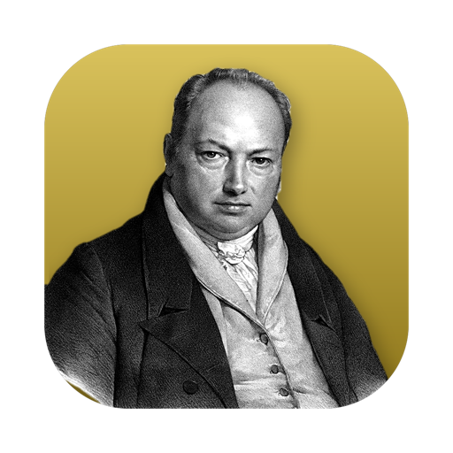

<div align="center">
  
  <h1>Torno</h1>
  <p><strong>A parametric 3D CAD application for the Nodalia suite, built on the SolidCraft engine.</strong></p>

  <p>
    
    
    
    
  </p>

  <p>
    <a href="#overview">Overview</a> ·
    <a href="#what-you-get-today">Today</a> ·
    <a href="#build-and-run">Build</a> ·
    <a href="#project-status">Status</a> ·
    <a href="#keeping-up-with-upstream">Upstream</a> ·
    <a href="#the-nodalia-suite">Suite</a> ·
    <a href="#license">License</a>
  </p>
</div>

---

## Overview

**Torno** is the parametric 3D CAD application of [Nodalia](https://getnodalia.com). It is built on the engine of
[SolidCraft](https://github.com/tangency-labs/solidcraft), which lives in this repository and is kept up to
date with upstream.

> [!IMPORTANT]
> **Torno is at an early stage.** What runs today is the upstream application.
> Nodalia's own interface is not wired in yet and there are no published builds.

## What you get today

- The SolidCraft engine.
- The upstream desktop application. Crate and binary names are still upstream's.
- The engine's own feature description, kept as [`docs/upstream-readme.md`](docs/upstream-readme.md).

## Build and run

You need a recent stable Rust toolchain.

```bash
git clone https://github.com/danielmigueltejedor/torno.git
cd torno
cargo run --release -p solidcraft
```

The crate is still called `solidcraft`; it will be renamed with the product.

## Project status

| Area | State |
|---|---|
| Engine | Imported from `tangency-labs/solidcraft` and tracked in [`docs/upstream.md`](docs/upstream.md) |
| Product name | Pending: crates and binary still carry upstream's name (`solidcraft`) |
| App icon | Designed, not applied yet: upstream draws its icon from code |
| Nodalia interface | Not started |
| Shared interface resources | Planned: the Nodalia apps will share interface components and styles |
| Installable packages | None published |

## Keeping up with upstream

[`docs/upstream.md`](docs/upstream.md) records which upstream commit is integrated. Updates are
merges of upstream's `main`, so Torno's own changes are kept and conflicts are resolved in the open.

## App icon

Nodalia app icons are black-and-white portraits of historical figures over the app colour.
Torno's is Henry Maudslay, who invented the modern screw-cutting lathe. It is not applied yet: upstream generates its icon from code, so adopting the portrait needs a code change.

## The Nodalia suite

Torno is one of the applications of [Nodalia](https://getnodalia.com), an independent software
project developed in public by [Daniel Miguel Tejedor](https://danielmigueltejedor.com).

## License

`MIT OR Apache-2.0`, as upstream. The licence files and `NOTICE` of SolidCraft are kept.
See [`LICENSE-MIT`](LICENSE-MIT) and [`LICENSE-APACHE`](LICENSE-APACHE).

SolidCraft's name and logo are covered by upstream's [`LICENSE-BRAND`](LICENSE-BRAND) and are not
part of that grant. This project uses its own name, Torno.

## Credits

Torno would not exist without [SolidCraft](https://github.com/tangency-labs/solidcraft) and its contributors.
