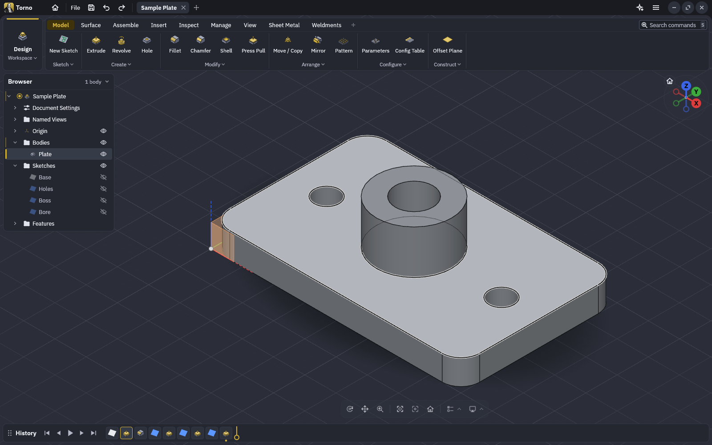
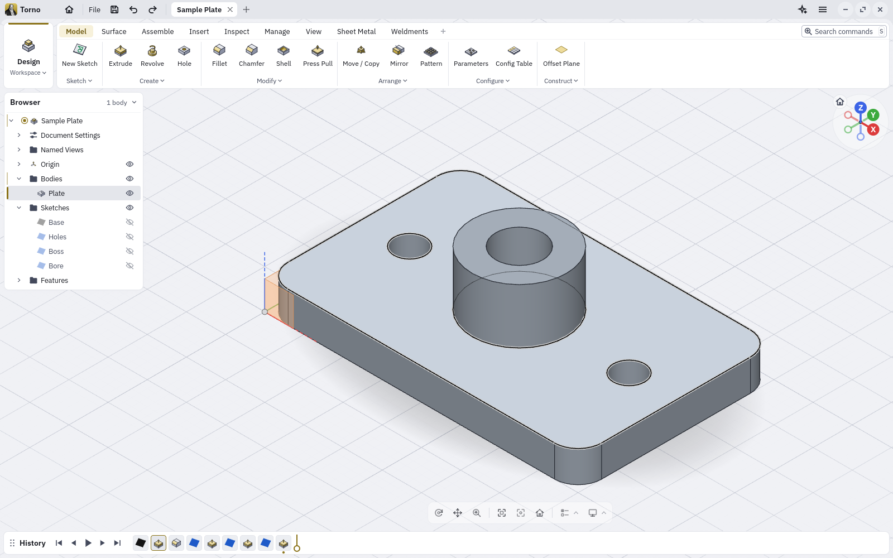
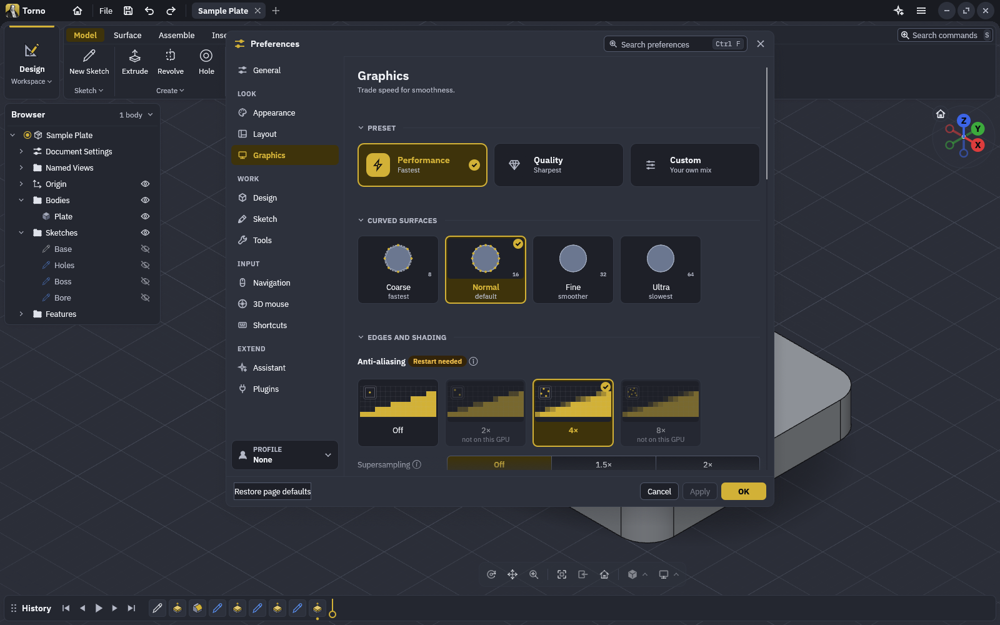

<div align="center">
  <a href="https://getnodalia.com">
    
  </a>
  <br><br>
  
  <h1>Torno</h1>
  <p><strong>The parametric 3D CAD application of the Nodalia suite.</strong></p>

  <p>
    
    
    
  </p>

  <p>
    <a href="#screenshots">Screenshots</a> ·
    <a href="#what-it-does">What it does</a> ·
    <a href="#build-and-run">Build</a> ·
    <a href="#agents-and-the-command-line">Agents</a> ·
    <a href="#project-status">Status</a> ·
    <a href="#the-nodalia-suite">Suite</a> ·
    <a href="#license">License</a>
  </p>
</div>

<p align="center">
  
</p>

---

## Overview

**Torno** is the parametric 3D CAD application of [Nodalia](https://getnodalia.com). You sketch,
constrain, extrude and revolve, and every step stays editable on a timeline. It is a native app
written in Rust, with no account and no cloud, and it wears Nodalia Design: rounded islands, the
suite's line icons with Torno's gold, and the suite's own window controls on Linux.

> [!IMPORTANT]
> **Torno is at an early stage.** There are no published builds yet. Expect rough edges, and keep a
> copy of designs that matter.

## Screenshots

<table>
  <tr>
    <td width="50%"></td>
    <td width="50%"></td>
  </tr>
  <tr>
    <td><sub><b>Light theme</b>: the same design in the light palette.</sub></td>
    <td><sub><b>Preferences</b>: every setting in one window, searchable.</sub></td>
  </tr>
</table>

## What it does

- **Sketches and constraints.** Lines, arcs, splines, text and more, solved by Torno's own
  constraint solver, with dimensions driven by parameters.
- **Features on a timeline.** Extrude, revolve, sweep, loft, fillet, chamfer, shell, draft, holes,
  threads, patterns, mirror, split and combine, all editable after the fact.
- **Parameters and configurations** with unit-aware expressions.
- **Assemblies** with joints, motion studies, contact sets, interference and mass properties.
- **Sheet metal** with flanges, hems, fold and unfold, and flat patterns.
- **Open files.** STEP, IGES, 3MF, STL, OBJ and glTF in and out where supported, and URDF export.
- **Nodalia Design.** Light and dark themes, the main menu with Preferences, Keyboard Shortcuts and
  About, and the choice between Nodalia's window controls and the desktop's own on Linux.

## Build and run

You need a recent stable Rust toolchain.

```bash
git clone https://github.com/getnodalia/torno.git
cd torno
cargo run --release -p torno
```

## Agents and the command line

Everything Torno does is a command, and the desktop app, the headless `torno-cli` and its MCP
server all run the same commands. `torno-cli mcp setup` adds Torno to the AI assistants installed on
the machine; the guides in [`skills/`](skills) describe how an agent builds and edits a part.

## Project status

| Area | State |
|---|---|
| Nodalia interface | Palette, icons, main menu and window controls done |
| Installable packages | None published yet |
| Global menu in the shell's top bar | Planned |

## The Nodalia suite

Torno is one of the applications of [Nodalia](https://getnodalia.com), an independent software
project developed in public by [Daniel Miguel Tejedor](https://danielmigueltejedor.com).

## License

`MIT OR Apache-2.0`. See [`LICENSE-MIT`](LICENSE-MIT), [`LICENSE-APACHE`](LICENSE-APACHE) and
[`NOTICE`](NOTICE).
